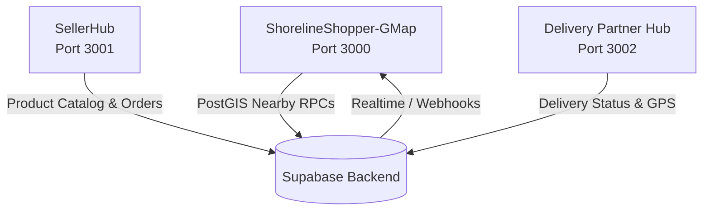

# LocalShore Shopper (`ShorelineShopper-GMap`)

> **Comprehensive Architecture, Data Flow, and AI Engineering Guide**  
> *Targeted for future AI agents and software engineers maintaining and extending the LocalShore platform.*

---

## 📑 Table of Contents

1. [Architecture Overview](#1-architecture-overview)
2. [Module Boundaries & Core Isolation](#2-module-boundaries--core-isolation)
3. [Persistent Shopping Cart System](#3-persistent-shopping-cart-system)
4. [Location, Mapping & Shop Discovery Engine](#4-location-mapping--shop-discovery-engine)
5. [Checkout, Distance & Pin Resolution](#5-checkout-distance--pin-resolution)
6. [Database Schema, Views & RPCs](#6-database-schema-views--rpcs)
7. [Environment Configuration](#7-environment-configuration)
8. [Automated Verification & Test Suite](#8-automated-verification--test-suite)
9. [Gotchas & Golden Rules for Next AI](#9-gotchas--golden-rules-for-next-ai)

---

## 1. Architecture Overview

`ShorelineShopper-GMap` is the high-performance, customer-facing progressive storefront for LocalShore. It allows neighborhood shoppers to pinpoint their delivery location, discover nearby verified local vendors within a 0–10 km radius, purchase groceries/goods with real-time stock checks, and track orders from dispatch to doorstep.

### Technology Stack

| Layer | Technologies |
|---|---|
| **Framework** | React 19 + TanStack Start (SSR/Isomorphic Server Functions) |
| **Routing** | TanStack Router (File-based routes in `src/routes/`) |
| **State & Cache** | TanStack Query (`@tanstack/react-query`) + Custom Reactive Stores |
| **Database & Auth** | Supabase (PostgreSQL 15+, PostGIS spatial extensions, RLS, Storage) |
| **Maps & Spatial** | Dual engine: Google Maps API (`VITE_MAP_PROVIDER=google`) & Leaflet/MapLibre GL OSM |
| **Payments** | Razorpay SDK (Server functions with HMAC-SHA256 signature verification) |
| **Styling** | Tailwind CSS v4 + Vanilla Design System Tokens & OKLab Color Mix |
| **Testing** | Node.js Test Runner (`node:test`) + TypeScript compiler (`tsc --noEmit`) |

### Workspace Relationship

The workspace is a monorepo consisting of:
- **`ShorelineShopper-GMap`** (Port 3000 / 8080): Active shopper storefront.
- **`SellerHub`** (Port 3001 / 8082): Vendor onboarding, store management, and **canonical Supabase migrations source** (`SellerHub/supabase/migrations/`).
- **`Delivery Partner Hub`** (Port 3002 / 8081): Courier PWA for delivery dispatch, route tracking, and proof-of-delivery.



---

## 2. Module Boundaries & Core Isolation

This codebase enforces strict **Four-Owner Domain Boundaries** validated by `scripts/check-module-boundaries.mjs`:
- `src/modules/shopper/` - Private shopper domain logic (cart, orders, addresses).
- `src/modules/seller/` - Private vendor operations.
- `src/modules/delivery/` - Private courier workflows.
- `src/shared/core/` - Immutable shared types and contracts (validated via SHA256 hashes in `src/shared/core/manifest.json`).

> ⚠️ **Rule for Next AI:** Never import private module internals across domain boundaries. Always run `npm run check:boundaries` before and after modifying imports.

---

## 3. Persistent Shopping Cart System

The shopping cart implementation mirrors the resiliency and UX patterns of Amazon, Flipkart, and Zepto.

### Core Files
- `src/modules/shopper/services/persistent-cart.ts`: Persistent storage adapter with dual-layer synchronization.
- `src/modules/shopper/services/cart-store.ts`: In-memory reactive state with subscription listeners.

### Cart Resiliency Model
1. **Dual-Layer Synchronization**:
   - **Local Cache (`localStorage`)**: Saves immediate state synchronously to eliminate UI flicker on refresh.
   - **Remote Database (`cart_items`)**: Synchronizes with Supabase for authenticated users to enable cross-device persistence.
2. **Guest Session Continuity**:
   - Guest carts are tracked using a persistent client UUID (`localshore_guest_session_id`).
   - Guest items survive browser reloads, tab closures, and overnight visits.
3. **Seamless Guest-to-User Merge**:
   - When a guest signs in (`auth.user` becomes available), `persistentCart.migrateGuestCartToUser(userId)` merges the guest lines into the user's account in Supabase.
   - If the same product exists in both, quantities are intelligently merged up to available stock.
4. **Composite Line Identity**:
   - Cart lines are keyed by `${storeId}:${productId}`. Products with identical IDs from different shops remain strictly segregated.
5. **Toast Repetition Suppression**:
   - Session toasts (such as "Welcome back") use fixed Sonner IDs (`id: "welcome-back-cart-toast"`) and are suppressed on `/cart` and `/checkout` to avoid repetitive intrusive alerts.
6. **Checkout Clearance**:
   - Upon order confirmation in `src/routes/checkout.tsx`, `persistentCart.clearCartOnCheckout(userId)` purges both local and database cart items atomically.

---

## 4. Location, Mapping & Shop Discovery Engine

### Location Selection Lifecycle
1. **Zero-Default Accuracy**: The platform never silently assumes hardcoded coordinates.
2. **Explicit Confirmation**: Delivery coordinates must be confirmed by the shopper via GPS detection or pin placement on the interactive map (`isConfirmedDeliveryLocation`).
3. **Reverse Geocoding**: Converts coordinates to human-readable neighborhood/area names (`src/lib/geocoding.functions.ts`).

### Strict Nearest-to-Farthest Shop Discovery (0 to 10 km)
- **Engine**: `src/lib/map-service/store-engine.ts` & `src/lib/location-visibility.ts`.
- **Database Functions**:
  - `discover_nearby_shops`: Primary PostGIS RPC computing precise geodesic distances.
  - `get_customer_visible_shops`: Automatic graceful fallback if newer zone RPCs are absent.
  - `imported_shops`: GeoJSON-imported shops ingested via `scripts/import-geojson-shops.mjs`.
- **Sorting Logic**:
  - Distance is calculated using the spherical Haversine formula (`haversineDistanceKm` in `src/lib/geo.ts`).
  - Shops are strictly sorted in ascending order from nearest to farthest (e.g. 0.4 km, 1.2 km, 3.5 km ... up to selected radius).
  - Radius filter toggles: **5 km**, **7 km**, and **10 km** max bounds.
  - Each shop card displays distance badges (`1.2 km away`) and estimated delivery times (`~25 min`).

---

## 5. Checkout, Distance & Pin Resolution

### Shop Pin Resolution (`useShopCoordinates`)
Located at `src/hooks/use-shop-coordinates.ts`:
```ts
useShopCoordinates(storeId: string | null)
```
- **Resolution Strategy**:
  1. Checks `imported_shops` table for `imported:*` prefixed IDs.
  2. Queries `approved_vendor_catalog` for approved vendor latitude/longitude.
  3. **Resilient Fallback**: If missing or unapproved, directly checks `sellers` table (`lat, lng`).
  4. Returns `{ lat, lng }` or `null` gracefully without throwing uncaught query errors.
- **Checkout Guard in `src/routes/checkout.tsx`**:
  ```tsx
  // Fallback to static store registry if known
  const knownStore = cart.storeId === APPROVED_STORE.id ? APPROVED_STORE : (cart.storeId ? getStore(cart.storeId) : undefined);
  const shopPin = shopCoordinates.data ?? knownStore;
  ```
  - **Error Display Rule**: The red alert `"Shop location could not be loaded"` is ONLY rendered if `shopCoordinates.isError && (!shopPin || !isValidCoordinate(shopPin.lat, shopPin.lng))`.
  - When `shopPin` is already valid (e.g. from `knownStore` or static catalog) and the straight-line distance is computed (`18.2 km straight-line · ~101 min`), false error banners are strictly suppressed.

---

## 6. Database Schema, Views & RPCs

Canonical migrations reside in `SellerHub/supabase/migrations/`.

### Key Tables & Views

| Entity | Type | Purpose |
|---|---|---|
| `cart_items` | Table | Persistent multi-device user cart storage (`user_id`, `product_id`, `seller_id`, `quantity`). |
| `sellers` | Table | Vendor profiles with business metadata, status (`pending`, `approved`), and PostGIS spatial coordinates (`lat`, `lng`). |
| `approved_vendor_catalog` | View | Filtered view returning approved active sellers with verified coordinates and storefront media. |
| `imported_shops` | Table | External neighborhood shops imported from GeoJSON with category tags and coordinates. |
| `orders` | Table | Centralized order records containing item lines, delivery coordinates, status, and payment gateway refs. |

### Key Stored Procedures (RPCs)
- `discover_nearby_shops(p_lat, p_lng, p_radius_meters, ...)`: PostGIS query returning vendors within specified radius.
- `get_customer_visible_shops(p_lat, p_lng, ...)`: Legacy-compatible vendor listing with fallback capability.
- `get_customer_visible_products(...)`: Active, in-stock products matching customer operational zone.

---

## 7. Environment Configuration

Defined in `.env` (copy from `.env.example`). Never commit credentials to version control.

### Client-Exposed Variables (`VITE_` prefix)
```ini
VITE_SUPABASE_URL=https://<project-ref>.supabase.co
VITE_SUPABASE_PUBLISHABLE_KEY=sbp_...
VITE_MAP_PROVIDER=google          # Options: "google" or "osm"
VITE_GOOGLE_MAPS_API_KEY=AIzaSy...
VITE_SELLER_HUB_URL=http://localhost:3001
VITE_DELIVERY_HUB_URL=http://localhost:3002
VITE_RAZORPAY_KEY_ID=rzp_test_...
```

### Server-Only Secrets (Never prefix with `VITE_`)
```ini
SUPABASE_SERVICE_ROLE_KEY=eyJ...
RAZORPAY_KEY_ID=rzp_test_...
RAZORPAY_KEY_SECRET=...
RAZORPAY_WEBHOOK_SECRET=...
```

---

## 8. Automated Verification & Test Suite

The test suite runs with native Node.js test runner (`node:test`) and TypeScript compiler:

```bash
# 1. Verify Module Boundaries (0 violations required)
npm run check:boundaries

# 2. Run Map, Cart, Payment & Safety Regression Tests (94 passing tests)
npm run test:maps

# 3. TypeScript Static Typecheck (0 errors required)
npm run typecheck

# 4. Ingest GeoJSON Shop Data
npm run import:shops
```

### Test Coverage Highlights (`tests/`)
- `persistent-cart.test.mjs`: Tests guest persistence, cross-refresh recovery, multi-device restoration, guest-to-user cart merging, and isolation.
- `map-shop-ordering.test.mjs`: Confirms strict 0 to 10 km nearest-to-farthest ordering.
- `checkout-location.test.mjs`: Validates GPS accuracy gates, pin selection, and destination immutability.
- `architecture.test.mjs`: Ensures module boundaries and manifest hashes remain intact.
- `imported-razorpay.test.mjs`: Tests payment calculation and signature verification.

---

## 9. Gotchas & Golden Rules for Next AI

1. **Always Verify Module Boundaries**: Any new file or import must comply with `scripts/check-module-boundaries.mjs`. Do not bypass it.
2. **Never Fabricate Coordinates**: Do not invent fake coordinates for sellers or customers. If coordinates are missing, treat them as `null`/`NaN` and prompt the user gracefully.
3. **Canonical Migrations Belong in `SellerHub`**: When creating or reading database migrations, `SellerHub/supabase/migrations/` is the single source of truth for the entire workspace.
4. **Composite Cart Key Rule**: Never identify a cart line by `productId` alone. Always use `${storeId}:${productId}` to prevent collisions across vendors.
5. **Guard Query Errors with Existing Data**: If a remote query fails (e.g. `useShopCoordinates`), always verify if local/known data (`knownStore`) already satisfied the requirement before rendering red error alerts.
6. **Preserve Native Node Tests**: All unit tests in `tests/*.test.mjs` run via `node --test` with ES modules.
7. **Scraper Error Artifact Recovery**: Scraped Google Maps datasets occasionally contain offline browser error page titles like `"Google Maps can't reach the internet"`. Use `cleanShopName` from `@/lib/imported-shops` and `extractBusinessNameFromUrl` to recover the true business name from the `google_maps_url`, ensuring raw error strings are never rendered in breadcrumbs, cards, or storefront headers.

